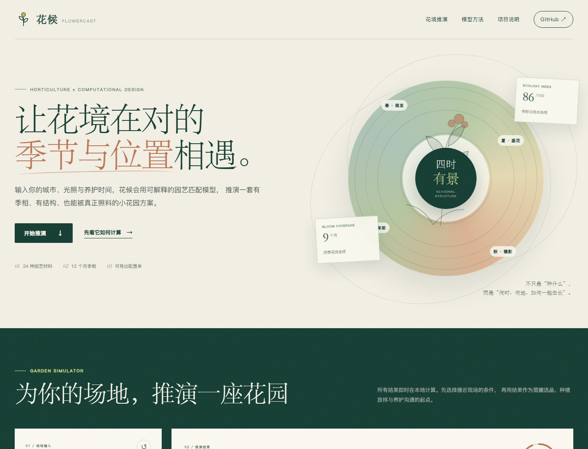
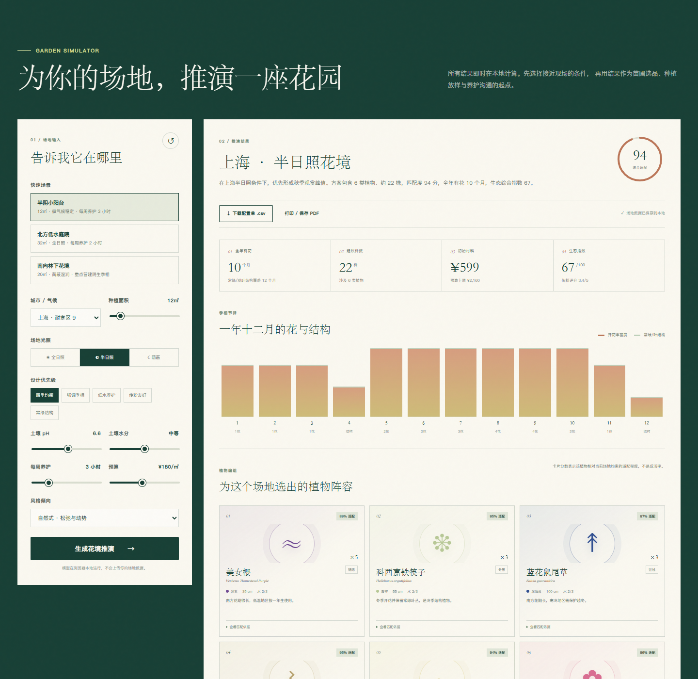

# 花候 FlowerCast

面向城市小花园、阳台和社区绿地的**四季花境配置与低维护推演模型**。输入城市、光照、土壤、面积与养护时间，自动生成植物编组、12 个月季相、示意布局、养护日历和经济情景，并支持下载 CSV 配置单。

在线体验：[https://yzme-5.github.io/huahou-flowercast/](https://yzme-5.github.io/huahou-flowercast/)





## 为什么做这个作品

园艺初学者常见的困难不是“找不到好看的花”，而是：

- 植物单看合适，放在一起后花期断档、层次混乱；
- 购买时忽略本地气候、pH、水分和养护能力；
- 花境维护需要持续判断，但纸质方案无法随场地条件变化。

FlowerCast 把园艺经验拆成可检查的光照、气候、pH、水分、养护和设计目标六类评分，再从 24 种植物中组合出连续季相。它不是生成一张效果图，而是一套能重新推演、解释依据并导出配置单的决策模型。

## 实际产出

- 可交互网页模型：输入条件后实时计算可解释的植物阵容
- 24 种观赏园艺植物数据库
- 12 个月花期与常绿/观叶结构覆盖图
- 自动生成的示意种植布局
- 四季养护任务日历
- 初始材料费、养护时间、灌溉量与生态指数估算
- 可下载的 UTF-8 CSV 植物配置单
- 打印样式，可浏览器“另存为 PDF”
- 3 组场景预设和场地数据本地保存

## 本地运行

项目无第三方运行时依赖。在项目目录运行：

```powershell
python -m http.server 8080
```

打开 `http://localhost:8080`。不能直接双击 `index.html`，因为浏览器会限制 ES Module 的本地加载。

## 测试

```powershell
npm test
```

测试覆盖三组预设场景、24 种植物数据完整性、评分边界、CSV 导出和极端场地风险提示。

## 文档

- [项目说明](docs/项目说明.md)
- [模型说明](docs/模型说明.md)
- [课程提交说明](docs/课程提交说明.md)
- [实验与验收记录](docs/实验记录.md)

## 项目结构

```text
.
├─ index.html
├─ assets/
│  ├─ plants.js       # 24 种植物数据库与场景预设
│  ├─ model.js        # 可解释匹配、季相、经济和风险模型
│  ├─ app.js          # 交互、SVG 布局、CSV 与本地保存
│  └─ styles.css      # 响应式与打印样式
├─ tests/
│  └─ model.test.mjs
├─ docs/
└─ .github/workflows/pages.yml
```

## 适用边界

植物参数来自课程原型阶段的公开园艺区间归纳，未完成多地区田间校准。模型输出用于方案讨论、材料预选和养护沟通，不构成成活率、产量或收益承诺。实际种植前应核对具体品种耐寒性、当地气候、土壤排水、入侵风险和苗圃可供材料。

## 许可

代码采用 [MIT License](LICENSE)。
